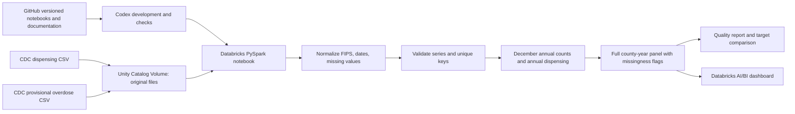

# Pipeline architecture

Source retrieval is manual until exact CDC endpoints and release versions are confirmed. Record download dates and source release metadata with each run. Databricks credentials belong in secure settings, never in GitHub.
