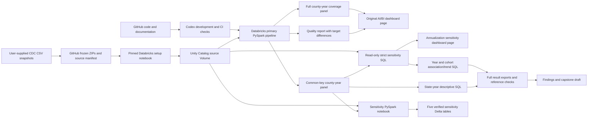

# Pipeline architecture

The primary and sensitivity pipelines, persisted Delta outputs, and live SQL paths have now been verified in Databricks. Source/window parity and independent summary checks are documented in `sensitivity_verification.md`. Both dashboard pages have user-reported review. No publication or automated Databricks job scheduling is implied.

CDC source landing pages are now verified; exact export/download and snapshot release provenance remain incomplete. The bootstrap retrieves versioned GitHub snapshots, not live CDC endpoints. See `reproducibility.md` for version pins, execution order, overwrite behavior, access requirements, and recovery after partial runs. Source hashes identify exact bytes; they do not establish original publication provenance. Credentials belong in secure connection settings, never in Git.
